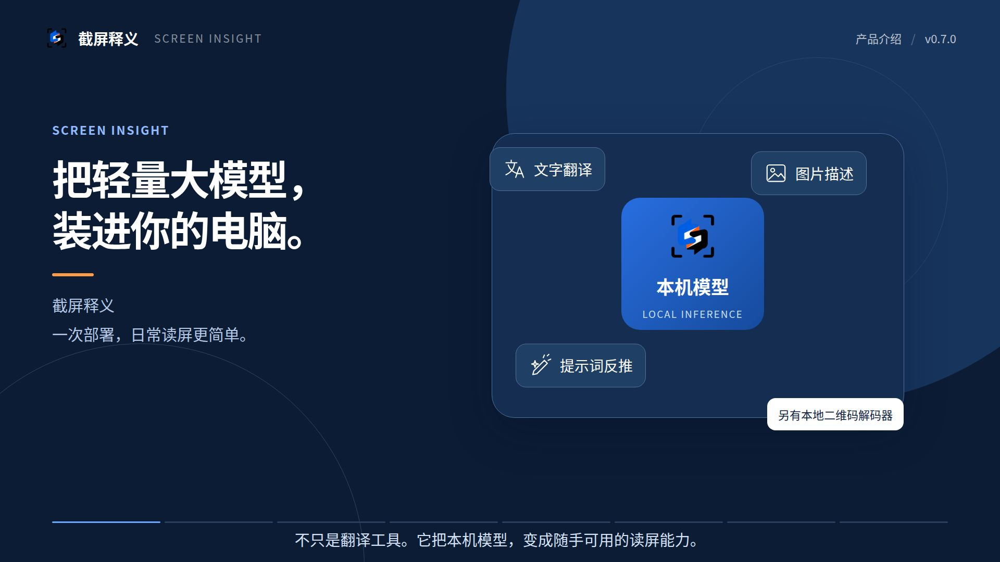
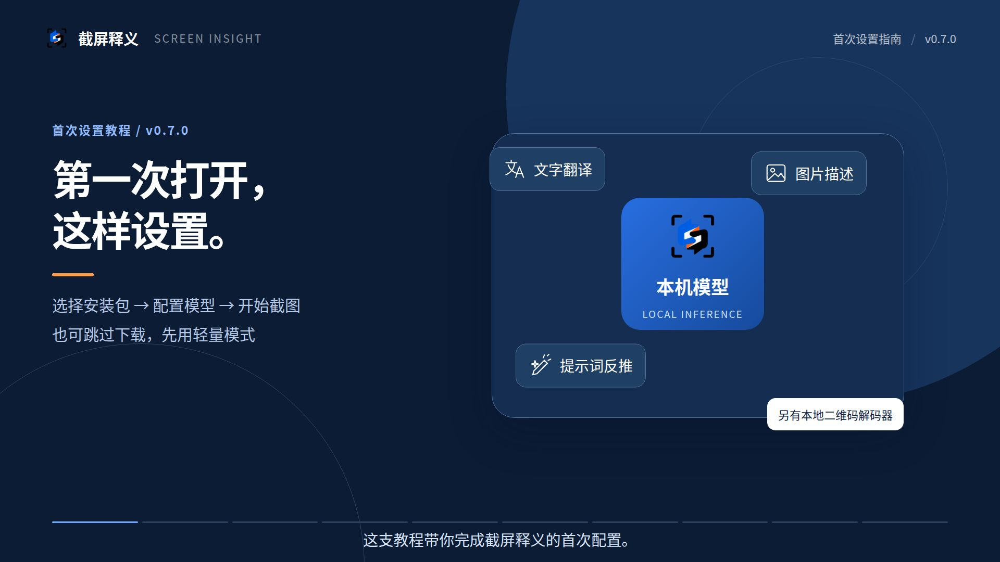

# Screen Insight

[简体中文](README.md) · English

A Windows / Ubuntu desktop tool for screenshot recognition, translation, image description and local QR decoding. **Recognition and translation share one current multimodal model.** Image description and prompt reconstruction use the same selection.

This README describes the unified multimodal architecture in v0.10.0. [Download packages and read upgrade notes](https://github.com/qingshihuan/pingyi/releases/tag/v0.10.0). Older releases retain the behavior documented for their version.

Windows v0.10.0 is unsigned. Free open-source signing is being prepared and has not been approved; future official releases require successful signature verification. [Code signing policy](docs/CODE_SIGNING_POLICY.md)

The [v0.10.1 performance preview](https://github.com/qingshihuan/pingyi/releases/tag/v0.10.1) displays fresh raw Windows capture pixels and encodes only the selected region after selection. See the [capture performance report](docs/CAPTURE_PERFORMANCE.md) for three-monitor measurements, render versus input readiness, reproduction and limitations. The release, application and package filenames use version `0.10.1`. This unsigned prerelease does not replace the stable release.

## Current model architecture

Only a model verified for **image input and text output** can be selected. A model appearing in an API catalog is not evidence of vision support. Text-only and unverified models remain manageable but cannot become the current model. Requests never silently fall back to another model or cloud service.

PaddleOCR, Baidu Cloud OCR, Google Cloud Vision, traditional OCR configuration and dependencies, the Python/Argos translation engine, and lightweight mode have been removed. There is no traditional OCR pre-pass, correction chain or offline translation fallback. Existing downloaded files are left on disk for rollback; new packages do not include them.

## Setup

1. Open Settings → **API models** to manage cloud HTTPS services and existing local API services such as Ollama / LM Studio in one list. Each service retains a separate key and model catalog.
2. Fetch model IDs or enter one manually. Run **Test text** and **Test vision**. Tests send synthetic content only; a remote service may charge for them. The vision challenge is random and its answer appears only in the image.
3. Select the verified model under **Current model**, then **Save and apply**. The same selection serves all model tasks.
4. **Local models** is the app's independent built-in functionality: download and run an app-owned multimodal model, manage runtimes and GPUs, and inspect runtime status without a cloud API. Existing local API connections belong under **API models**; external applications own their downloads and process lifecycle.

Settings has five sections: **Current model, API models, Local models, Hotkeys, General**. Local and cloud API profiles share one editor while retaining their IDs, capability evidence and credential references. Loading settings or fetching a model list does not select a model or start inference. App-owned setup verifies both capabilities before making the model current.

The runtime backend defaults to **Automatic (default)**: use a compatible GPU when available and fall back to CPU when no GPU is usable or GPU startup fails. Saved backend and GPU selections are retained. **Reset to default: Automatic** resets both choices to automatic; choose **Install and switch** to apply it.

**Detect and configure automatically** appears on the setup wizard's first screen and at the top of Local models. It detects hardware, prepares a usable runtime, reuses or downloads the model, verifies recognition and translation, then saves it as the current model. It reuses the configured model or starts with the recommended Qwen3.5 2B Q4 (about 1.82 GiB). The wizard returns to the main window after verified setup, supports retry on failure, and keeps manual model/runtime selection in an expandable section. Setup can be cancelled and retains unsaved API, key and general-setting drafts. See [runtime download sources](docs/RUNTIME_DOWNLOADS.md) for online and bundled versions.

## Capture and privacy

Home and runtime details update automatically after configuration saves and check local model state every two seconds while visible. API “Verified” means saved image/text capability evidence, not a live connectivity or quota check. Status refresh does not call APIs, download or start models, or overwrite setting drafts.

Use the main capture button, `Ctrl+Alt+D` on Windows, or `Ctrl+Shift+D` on Linux X11. Hotkeys can be recorded or edited under Hotkeys. Wayland uses the system screenshot portal and requires a desktop-managed global shortcut; see [Linux capture](docs/LINUX_CAPTURE.md).

Automatic capture first attempts local QR decoding. A decoded QR stays local; otherwise the current model recognizes and translates the image. Image description and prompt reconstruction remain explicit actions in the result window. Remote image/text requests require consent for that destination. QR decoding works without a configured model; other tasks explain when a current model is missing.

Remote transfer dialogs offer Cancel, Allow once, and Allow and remember. Remembered approval survives restart and covers desktop screenshot recognition, translation and image analysis only for the same service, address, protocol and model. New destinations require confirmation. Clear approvals under General → Reset remote transfer prompts. Only destination digests are added to existing local settings, without keys, screenshots or text; browser-extension consent remains separate.

Screenshots and results stay in memory. Cloud requests send the selected content to the chosen service, which may charge and apply its own retention policy. Local inference sends content only to the configured loopback service. Downloads and explicit update checks require networking; normal local inference does not require a cloud API.

## Configuration and API keys

The existing local storage mechanism is retained: Windows uses existing DPAPI files; Linux uses the existing Secret Service integration with its memory-only fallback. No new mandatory credential manager is introduced. Private configuration, secret directories and migration backups are ignored by Git. Keys are never embedded in README examples, release artifacts or request error messages.

Schema 16 preserves service IDs, destination-scoped keys, language and shortcuts. Before the first save, the original file is copied once to `settings.json.pre-v16.bak`; an existing backup is never overwritten. Conflicting or unverified legacy routes require explicit model selection. No local key, external server or downloaded model is deleted automatically. See [migration and rollback](docs/CONFIGURATION_MIGRATION.md).

The current Complete edition retains its existing data directories (`%LOCALAPPDATA%/PingYiComplete` or XDG `pingyi-complete`); historical Standard data stays in its separate directory and is not automatically merged. Exit the app and back up configuration and secrets before upgrading. `PINGYI_CONFIG_DIR` can isolate a development test session without using your normal configuration.

## Build and verify

.NET 10 SDK is required. Python is needed only for development/release checks, not application inference.

```powershell
dotnet restore PingYi.slnx
dotnet build PingYi.slnx -c Release
dotnet test PingYi.slnx -c Release
python -m unittest discover -s scripts -p "test_*.py"
python scripts/audit-secrets.py
```

The last command audits actual staged bytes. After committing, run `python scripts/audit-secrets.py --ref HEAD` before pushing. Release scripts audit unpacked output and reject retired engines, traditional OCR libraries and private configuration. Bundled .NET, llama.cpp CPU/Vulkan and license files remain; model weights are downloaded only on explicit request.

Windows packaging: prepare llama.cpp with `python scripts/prepare-llama-runtime.py --runtime win-x64 --destination artifacts/llama-runtime/win-x64`, then run `scripts/publish.ps1 -Version <version> -LlamaRuntimeSource artifacts/llama-runtime/win-x64`. Linux packaging uses `PINGYI_LLAMA_RUNTIME_SOURCE` and `bash scripts/publish.sh <version>`. These commands create local artifacts, not GitHub releases.

## Documentation

[Architecture](docs/ARCHITECTURE.md) · [Settings guide](docs/CONFIGURATION_CENTER.md) · [API protocols](docs/THIRD_PARTY_API.md) · [Migration](docs/CONFIGURATION_MIGRATION.md) · [Changelog](CHANGELOG.md) · [Backend management](docs/RUNTIME_SWITCHING.md) · [Browser extension](docs/BROWSER_EXTENSION.md) · [Third-party licenses](THIRD_PARTY_NOTICES.md)

## Historical videos

The following v0.7.0 videos are retained as historical material. Their mode choices, settings layout and traditional OCR behavior do not describe the current architecture.

<!-- screen-insight-videos:start -->
## Download the product and setup videos

**One-click local model setup turns screenshot translation, image description and reference prompts into desktop actions. QR codes use a separate local decoder, not the model.**

| Product introduction · 60 seconds | First-run guide · 1 minute 50 seconds |
| --- | --- |
| [](https://github.com/qingshihuan/pingyi/raw/refs/heads/main/docs/videos/screen-insight-intro-zh-CN.mp4) | [](https://github.com/qingshihuan/pingyi/raw/refs/heads/main/docs/videos/screen-insight-setup-zh-CN.mp4) |
| [Download introduction MP4](https://github.com/qingshihuan/pingyi/raw/refs/heads/main/docs/videos/screen-insight-intro-zh-CN.mp4) | [Download setup MP4](https://github.com/qingshihuan/pingyi/raw/refs/heads/main/docs/videos/screen-insight-setup-zh-CN.mp4) |

**Click a cover or download link to save the MP4, then open it in a local video player. The GitHub file preview is not an online player for these videos; its file-size warning does not mean the video is damaged.**

Made with Remotion: 1080p/30fps, Chinese captions and an original instrumental score, no voiceover. Native v0.7.0 UI with authored synthetic examples; process animations are not performance measurements. [Downloads, playback instructions and source](docs/videos/README.md) · [Windows upgrade and restart guidance](docs/WINDOWS_UPGRADE.md)

<!-- screen-insight-videos:end -->
