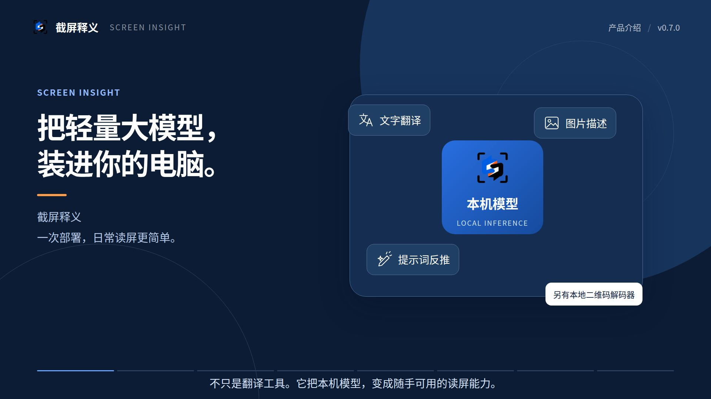
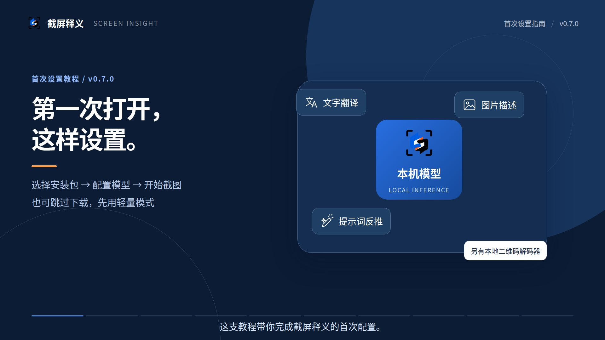

# 截屏释义

简体中文 · [English](README.en.md)

Windows / Ubuntu 桌面截图工具，支持识字、翻译、图片描述、提示词反推和本地二维码解析。**截图识字与翻译共用一个当前多模态模型**，图片描述与提示词反推也沿用同一选择。

本文描述 v0.10.0 的统一多模态模型架构。[下载安装包与查看升级说明](https://github.com/qingshihuan/pingyi/releases/tag/v0.10.0)。旧版功能以对应版本发布说明为准。

## 新模型架构

只有已验证支持 **图片输入和文本输出** 的模型才能设为当前模型。获取 API 模型列表不等于验证图片能力；纯文本或未验证模型可以保留在管理列表中，但不能选作当前模型。请求失败时显示错误，不会静默切换模型或云服务。

已彻底移除 PaddleOCR、百度云 OCR、Google Cloud Vision、传统 OCR 配置与依赖、Python/Argos 翻译引擎以及轻量模式。没有传统 OCR 预识别、纠错链或离线翻译回退。用户已有的下载文件留在原处供回滚使用，新安装包不再包含这些组件。

## 首次设置

1. 进入 **设置 → API 模型管理**，统一添加云端 HTTPS 服务或 Ollama、LM Studio 等本地 API 服务。每个服务保留独立密钥与模型列表。
2. 获取模型列表，或手动填写模型 ID，分别点击 **测试文字能力**、**测试图片能力**。测试只发送合成内容；远程服务可能计费。图片测试使用随机内容，答案只出现在图片中。
3. 在 **当前模型** 页选择已验证的模型，然后 **保存并应用**。所有模型任务使用这个选择。
4. **本地模型管理** 是独立的软件基础功能：下载并运行本软件托管的多模态模型，管理推理后端、显卡、启停和运行状态，无需云端 API。调用已有本地 API 则在 **API 模型管理** 配置，外部应用自行管理模型下载和进程生命周期。

设置分为五个页面：**当前模型、API 模型管理、本地模型管理、快捷键、通用设置**。本地与云端 API 在同一列表管理；已有服务标识、模型能力和密钥引用保持兼容。打开设置、获取模型列表不会自动选择模型或开始推理。托管模型设置会在文字和图片验证均通过后设为当前模型。

运行后端默认选择 **自动检测（默认）**：有适用显卡就用显卡，无可用显卡或显卡后端启动失败时自动回退 CPU。已有用户保存的后端和显卡选择继续保留；点击“恢复默认：自动检测”会将后端和执行显卡都设为自动，再点击“安装并切换到所选后端”应用。

配置向导首屏和本地模型管理顶部均提供 **一键检测并自动配置**：自动检测硬件、准备可用后端、复用或下载模型，验证识字和翻译后自动保存并设为当前模型。优先复用已配置模型，首次使用推荐的 Qwen3.5 2B Q4（约 1.82 GiB）。向导验证成功后返回主界面，失败可重试，也可展开手动选择模型与后端。过程可取消，其他页面未保存的 API、密钥和通用设置编辑会保留。后端在线下载与内置备用版本的区别见[下载来源核对](docs/RUNTIME_DOWNLOADS.md)。

## 截图与隐私

首页和运行状态详情会自动更新：保存配置后立即刷新，窗口可见时每两秒检查本地模型状态。API 的“已验证”表示已保存图片与文字能力测试结果，不代表本次检查了实时连通性或额度。刷新不联网请求 API、不下载或启动模型，也不覆盖设置草稿。

主界面点击截图，Windows 默认快捷键为 `Ctrl+Alt+D`，Linux X11 为 `Ctrl+Shift+D`，可在快捷键页录入或修改。Wayland 使用系统截图 portal，全局快捷键由桌面设置绑定，详见 [Linux 截图说明](docs/LINUX_CAPTURE.md)。

自动任务先在本地尝试二维码解码；成功则显示二维码，否则使用当前模型识字并翻译。图片描述和提示词反推在结果窗口手动选择。远程图片与文字请求需要对目标服务的授权。未配置模型仍可本地解码二维码，其他任务会提示选择当前模型。

远程发送弹窗提供“取消”“同意并继续”和“同意并不再提示”。记住的授权在重启后仍生效，仅用于同一服务、地址、协议与模型的截图识字、翻译和图片分析；新目标需重新确认。可在“通用设置 → 恢复远程发送确认”清除。授权保存在现有本地配置中，不包含密钥、截图或文本；浏览器扩展仍独立确认。

截图、识别和翻译结果保留在内存中，不写入持久历史。云端请求将所选内容发给当前服务，服务商可能计费并适用其数据政策。本地推理只向配置的回环服务发送内容；下载和主动检查更新需要联网，正常本地推理不需要云端 API。

## 配置迁移与 API Key

保留现有本地密钥存储方式：Windows 沿用 DPAPI 文件，Linux 沿用已有 Secret Service 集成及仅内存回退，不强制引入新的系统凭据库。用户配置、密钥目录及迁移备份均被 Git 忽略。文档示例、发布包和错误提示不得包含真实密钥。

配置升级到 schema 16 时保留服务标识、按目标地址隔离的密钥、语言及快捷键。首次保存前将原文件复制为 `settings.json.pre-v16.bak`，已有备份不覆盖。旧任务使用不同模型或能力未验证时，等待用户选择当前模型。迁移不自动删除本地密钥、外部服务或下载模型，详见 [迁移与回滚](docs/CONFIGURATION_MIGRATION.md)。

当前完全版继续使用 `%LOCALAPPDATA%/PingYiComplete` 或 XDG 下的 `pingyi-complete`；旧标准版的独立目录保留在原处，不自动合并。升级前请退出程序并备份配置和密钥；测试开发版可设置 `PINGYI_CONFIG_DIR` 使用隔离目录。

## 开发与验证

需要 .NET 10 SDK。Python 仅用于开发和发布检查，不参与应用推理。

```powershell
dotnet restore PingYi.slnx
dotnet build PingYi.slnx -c Release
dotnet test PingYi.slnx -c Release
python -m unittest discover -s scripts -p "test_*.py"
python scripts/audit-secrets.py
```

最后一条命令检查暂存区实际内容；提交后、推送前再运行 `python scripts/audit-secrets.py --ref HEAD`。发布脚本检查解包目录，拒绝旧引擎、传统 OCR 库和私有配置。安装包保留 .NET、llama.cpp CPU/Vulkan 与许可证；模型权重仅在用户主动下载时获取。

Windows 打包先运行 `python scripts/prepare-llama-runtime.py --runtime win-x64 --destination artifacts/llama-runtime/win-x64`，再运行 `scripts/publish.ps1 -Version <版本号> -LlamaRuntimeSource artifacts/llama-runtime/win-x64`。Linux 使用 `PINGYI_LLAMA_RUNTIME_SOURCE` 和 `bash scripts/publish.sh <版本号>`。这些命令仅生成本地产物，不发布 GitHub Release。

## 文档

[架构](docs/ARCHITECTURE.md) · [设置说明](docs/CONFIGURATION_CENTER.md) · [API 协议](docs/THIRD_PARTY_API.md) · [配置迁移](docs/CONFIGURATION_MIGRATION.md) · [更新记录](CHANGELOG.md) · [后端管理](docs/RUNTIME_SWITCHING.md) · [浏览器扩展](docs/BROWSER_EXTENSION.md) · [第三方许可](THIRD_PARTY_NOTICES.md)

## 历史视频

下列视频为 v0.7.0 历史资料，其模式选择、设置布局和传统 OCR 行为不代表当前架构。

<!-- screen-insight-videos:start -->
## 软件介绍与设置视频下载

**一键部署本机轻量大模型，让截图翻译、图片描述和参考提示词成为桌面常用能力。二维码由独立的本地解码器处理，不需要模型。**

| 软件介绍 · 60 秒 | 首次设置 · 1 分 50 秒 |
| --- | --- |
| [](https://github.com/qingshihuan/pingyi/raw/refs/heads/main/docs/videos/screen-insight-intro-zh-CN.mp4) | [](https://github.com/qingshihuan/pingyi/raw/refs/heads/main/docs/videos/screen-insight-setup-zh-CN.mp4) |
| [下载介绍 MP4](https://github.com/qingshihuan/pingyi/raw/refs/heads/main/docs/videos/screen-insight-intro-zh-CN.mp4) | [下载设置 MP4](https://github.com/qingshihuan/pingyi/raw/refs/heads/main/docs/videos/screen-insight-setup-zh-CN.mp4) |

**点击封面或下方链接下载 MP4，再用本地播放器打开。GitHub 文件预览页不提供这两支视频的在线播放；“文件过大，无法显示”不代表视频损坏。**

Remotion 制作，1080p／30fps，中文字幕与原创配乐，无旁白。使用 v0.7.0 原生界面和合成示例；流程动画不是实测耗时。[下载、播放说明与源码](docs/videos/README.md) · [旧版升级与重启排障](docs/WINDOWS_UPGRADE.md)

<!-- screen-insight-videos:end -->
