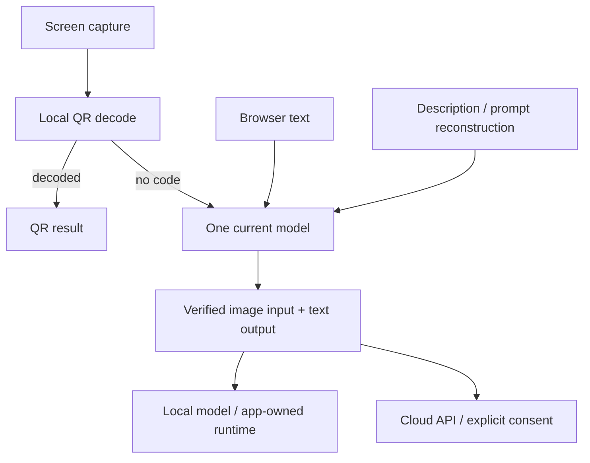

# Unified multimodal model architecture (schema 16)

This document describes unreleased main. Earlier release notes are historical.

## Request flow

`ModelConfiguration.CurrentModel` contains one service ID and one model ID. There are no independent task bindings or processing modes. `ModelTasks` identifies request types only. `ConfigurationRouting.Resolve` validates capabilities and returns the same endpoint, model, protocol and credential scope for recognition, translation, description and prompt reconstruction. Factories capture an immutable settings snapshot; a later settings edit cannot redirect an in-flight request.

`ModelCatalogEntry` records separate text and vision test evidence. Discovery does not set either flag. Text verification requires an actual nonempty text response. Vision verification renders a random challenge in a synthetic PNG and checks that the output contains its answer; the answer is never included in the request text. Changing the endpoint, protocol or credential invalidates evidence in the editor. Unverified and text-only entries cannot be saved as current or routed at runtime.

## Configuration boundaries

| Section | Responsibilities |
| --- | --- |
| Current model | One verified model for all tasks; translation language |
| API models | Existing local and cloud services in one editor; per-service keys, protocols, catalogs and capability tests |
| Local models | Built-in app-owned model download, runtime installation, GPU selection, start/stop and backend switching |
| Hotkeys | Record/edit shortcut, conflict handling and platform guidance |
| General | Interface language, startup and explicit update checks |

`Services` contains cloud profiles; `LocalServices` contains loopback profiles. A single API model editor loads both collections and partitions them by endpoint when saving, retaining schema 16, service IDs and credential references. App-owned llama.cpp deployment is a separate built-in feature; switching to an API model does not erase local installation preferences. External Ollama/LM Studio instances retain ownership of their processes and model lifecycle; the app only connects and tests them. Status cards count external local services as API models, not app-owned deployments.

The setup wizard and Local models one-click actions delegate to `ConfigureLocalModelAutomaticallyAsync`: refresh hardware, select a usable installed runtime or explicitly install missing components, reuse the configured model or select the recommendation, check/download its weights, start with automatic GPU/CPU selection, verify vision and text, then save the current model. Configuration is committed only after verification; cancellation or activation failure retains settings and attempts bounded restoration of an owned previous model. The wizard returns `Ready` only after this verified save, retains failure/cancellation for retry, and exposes manual choices in an expandable section. The settings UI applies only the local/current-model result, keeping API credential drafts, hotkeys and general edits in memory. Runtime downloads resolve official stable metadata; bundled/offline fallback versions are tracked separately in `RUNTIME_DOWNLOADS.md`.

## Layers

`PassiveStatusUpdater` coalesces UI-thread refresh requests and polls every two seconds only when the consuming window/page can refresh. Saved settings notify both views immediately; the status cache also compares passive model/process evidence, so startup/exit does not retain an idle/running cache entry. Refresh cancellation follows window lifetime. Snapshots with stale settings are discarded, and unchanged snapshots preserve operation feedback and detail controls. API capability evidence maps to `Verified` (not live `Available`); reading status never probes an API or starts inference.

- `PingYi.Core`: configuration, migration conversion, capability rules, routing, capture purposes, runtime policy and contracts.
- `PingYi.Infrastructure`: compatible Chat Completions / Responses adapters, QR decoding, local settings and secret storage, model/runtime downloads and process ownership, desktop capture and browser bridge.
- `PingYi.App`: five-page draft editor, explicit capability tests, capture consent, cancellation, result windows and runtime controls.

PaddleOCR, ONNX Runtime, Baidu OCR/translation, Google Vision/translation, Python/Argos/CTranslate2 and all traditional OCR installers are removed. No Python inference host or lightweight mode remains. The `IOcrProvider` interface now represents multimodal transcription only. No failures trigger another model or traditional engine. Automatic capture uses local QR evidence only; other images go to the current multimodal model for recognition and translation.

## Persistence and migration

`JsonSettingsStore` loads older settings without rewriting them. `ConfigurationMigration` splits local/cloud profiles while preserving service IDs (and therefore credential references). An unambiguous previously verified shared model may remain selected; conflicting or unverified routes become a pending suggestion. Removed settings remain recoverable in the original backup. Invalid/future files fail explicitly instead of being silently replaced.

Before the first schema 16 save, the original bytes are copied to `settings.json.pre-v16.bak` if that backup does not already exist. Saves use a temporary file and atomic replacement. Configuration changes and scoped secret writes are serialized; a failed settings write restores the previous key values. Legacy shared keys are copied only to the matching original destination, never overwrite a scoped key, and remain available for rollback. Migration does not delete old model files or secrets.

Windows DPAPI and the existing Linux Secret Service/memory fallback remain unchanged. API keys are not serialized into model configuration. Runtime request adapters receive only the selected service's key; app-owned loopback inference receives no cloud key. Private settings, secrets and backups are ignored and audited before commits, pushes and packaging.

## Verification and limits

Core tests cover routing identity, capability rejection, protocol payloads, credential isolation and rollback, cancellation, backups, migration, runtime downloads/process ownership and capture. Avalonia tests exercise settings navigation, credential drafts, capability selection, hotkeys, cancellation, themes and viewport layouts. Python checks cover packaging/licenses, secret audits and UI/resource consistency. Native Linux/X11 and screenshot portal checks run in CI.

Capability tests demonstrate connectivity and synthetic image reading, not real-world OCR accuracy or speed. Provider catalogs, actual cloud permissions and GPU inference require testing on the chosen account/device. No release is published by this refactor.
